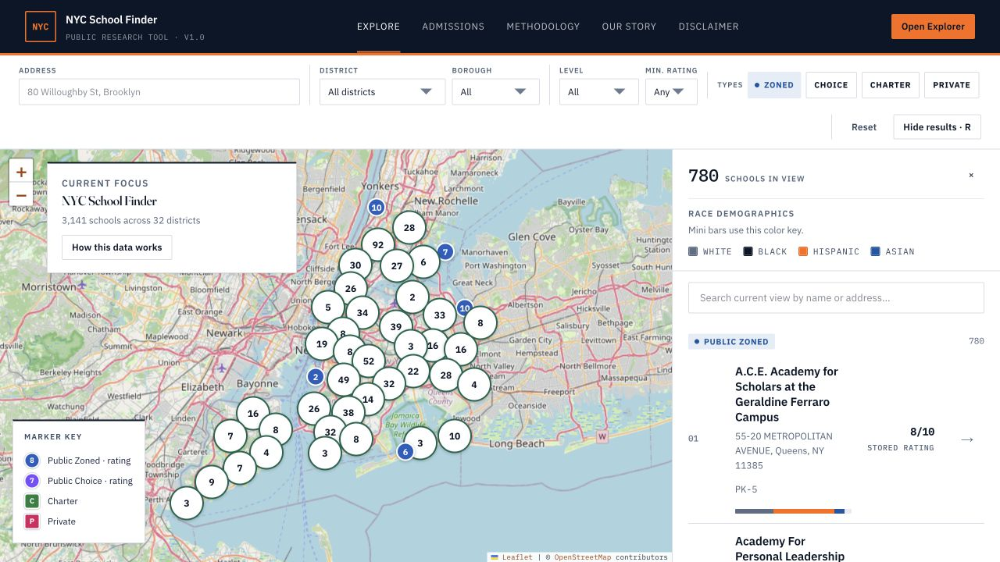
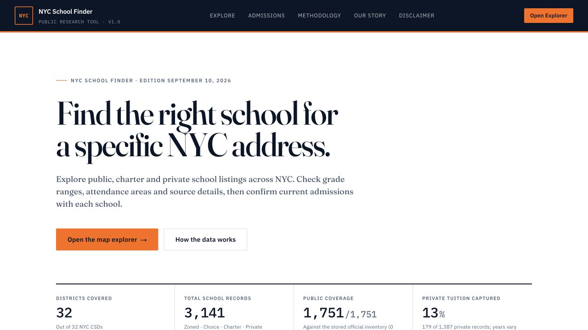

# NYC Schools

SearchNYCSchools.com — a free school research tool for NYC families.

[Explore NYC schools →](https://searchnycschools.com)

## Start with a place. Understand the options.

Explore public, charter and private school listings across New York City, with school and district profiles that keep source details and reporting years in view.

- Search by address or school and move between map and list views.
- Filter by district, borough, school type and grade level.
- Explore school profiles, district pages and admissions guidance.
- Inspect source notes, coverage limits and dated information.

## Project

**Status:** Live, free public research tool.

**Built with:** Next.js, React, TypeScript and Leaflet.

This repository presents the product. Application source is maintained privately.

*Screenshots are from the public website. School data is published as dated editions, with source links and coverage notes.*
